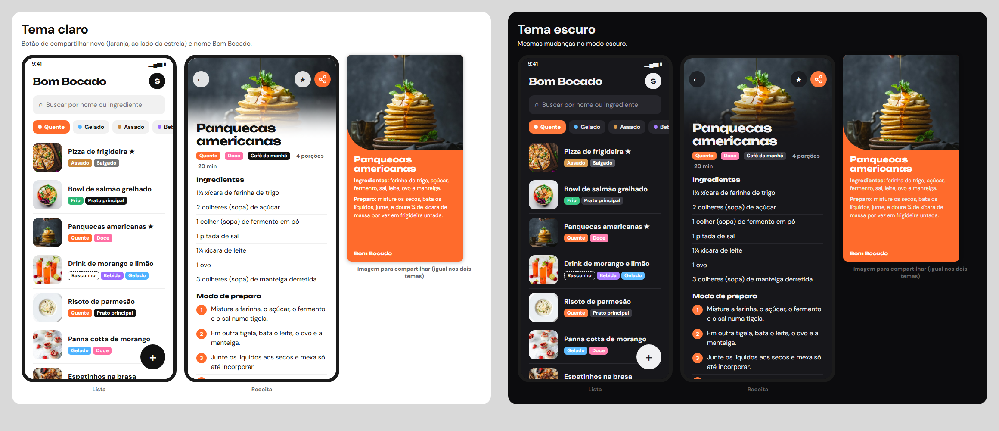
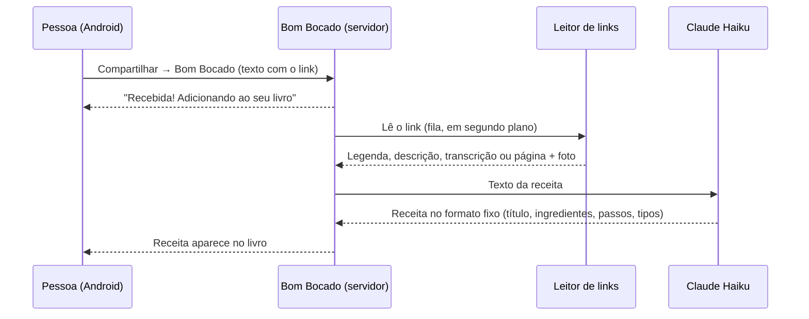
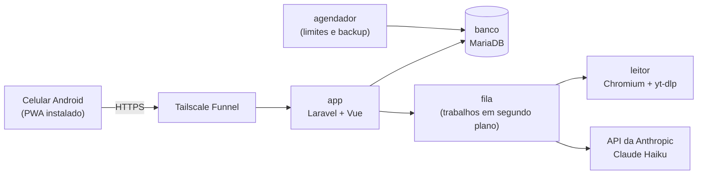

# Bom Bocado

Um livro de receitas para o celular Android. Viu uma receita no Instagram, no YouTube ou num site? Toque em **Compartilhar → Bom Bocado** e pronto: o app lê o link, monta a receita com ingredientes e modo de preparo, escolhe os tipos (quente, gelado, assado, bebida…) e guarda no seu livro. Sem formulário e sem perguntas.

> **Situação:** em construção. Os testes de viabilidade terminaram e o esqueleto do app está pronto: login sem cadastro aberto, visual do Bom Bocado nos temas claro e escuro, ícone e instalação como app (PWA). A próxima etapa é publicar a primeira versão para instalar no celular. O andamento está no [roteiro](#roteiro) abaixo.



*Protótipo aprovado: lista de receitas, tela da receita e imagem para compartilhar, nos temas claro e escuro.*

## O que o app faz

- **Adiciona receitas pelo Compartilhar do Android.** Funciona com posts e reels do Instagram, vídeos e Shorts do YouTube e páginas de sites de receita.
- **Organiza sozinho.** Uma IA (Claude Haiku, da Anthropic) transforma o texto do post, a descrição do vídeo ou a página numa receita padronizada, em português, mesmo quando a original está em outro idioma.
- **Busca por nome ou ingrediente.** "frango", "leite condensado", "acucar" (sem acento também vale).
- **Filtra por tipo**, cada um com sua cor: quente, frio, gelado, assado, frito, bebida, doce, salgado, sobremesa e outros.
- **Livros compartilhados.** Cada pessoa tem seu livro pessoal e pode criar livros com a família ou amigos.
- **Compartilha a receita como imagem** no formato de story, pronta para o WhatsApp ou o Instagram.
- **Abre receitas já vistas sem internet** e mantém a tela ligada enquanto você cozinha.
- **Acesso por convite.** Não há cadastro aberto: o administrador convida as pessoas.

## Como uma receita entra no livro



Se algo der errado (post privado, vídeo sem a receita escrita, limite de uso atingido), a receita entra como **rascunho** com o link guardado, para completar à mão depois. Nada se perde.

## O que os testes mostraram

Antes de escrever o app, testamos o caminho mais arriscado com 9 receitas reais (3 do Instagram, 3 do YouTube, 3 de sites). Os relatórios completos estão em [`pesquisa/`](pesquisa/).

| Origem | Como a receita é lida |
|---|---|
| Instagram | Só abrindo o link num navegador sem tela: a legenda inteira do post vem nos metadados da página. Uma requisição simples volta sem a legenda. |
| YouTube | A descrição do vídeo costuma ter a receita. Quando tem só os ingredientes, ou quando é um Short falado, usamos a legenda automática do vídeo (via [`yt-dlp`](https://github.com/yt-dlp/yt-dlp)). |
| Sites | Sites de receita publicam os dados no padrão [schema.org/Recipe](https://schema.org/Recipe). Quando não publicam (uma notícia com receita no meio do texto, por exemplo), o texto da página vai para a IA. |

As 9 receitas foram extraídas. O custo médio foi de **US$ 0,0009 por receita** com o Claude Haiku 5.5, menos de 1 centavo de real. Mil receitas custam cerca de US$ 0,90.

## Tecnologias

| Parte | Escolha |
|---|---|
| App no celular | PWA (app web instalável pelo Chrome), com *Web Share Target* para aparecer no menu Compartilhar do Android |
| Servidor | Laravel (PHP 8.5) com Inertia e Vue 3 |
| Banco de dados | MariaDB 11.4 |
| Leitura dos links | Chromium sem tela (Instagram) e `yt-dlp` (legendas do YouTube) |
| Extração das receitas | API da Anthropic, modelo Claude Haiku 5.5, com saída estruturada |
| Hospedagem | Docker num computador de casa, publicado na internet pelo [Tailscale Funnel](https://tailscale.com/kb/1223/funnel) |

O app não funciona no iPhone: o iOS não deixa um app web aparecer no menu Compartilhar.

## Arquitetura



Cada caixa é um contêiner Docker, menos o Funnel e a API da Anthropic, que são serviços externos.

## Privacidade e segurança

- **Nenhum segredo fica neste repositório.** Chaves de API, senhas do banco e do e-mail ficam em arquivos `.env` que não vão para o Git. O modelo de cada um, sem valores, está em `.env.example`.
- **O que o app guarda:** nome, e-mail, senha (com hash), foto de perfil, as receitas e suas fotos, e o registro de uso da IA (para os limites de custo).
- **Quem vê o quê:** o livro pessoal é privado. Num livro compartilhado, todos os membros veem as receitas, mas só quem criou uma receita pode editá-la ou apagá-la.
- **Excluir a conta** apaga o livro pessoal e os dados da pessoa na hora, sem precisar pedir a ninguém.
- **Leitura de links:** o servidor só abre endereços `http` e `https` públicos, nunca endereços da rede interna, e com limite de tempo e de tamanho.
- **Limites de uso:** cada pessoa tem uma cota diária de receitas lidas pela IA, e há um teto de gasto mensal para o app todo.

## Rodando o projeto

O app está no começo: tem o login, o visual e a instalação como app, mas ainda não tem as telas de receitas. Você precisa de PHP 8.5 com Composer, Node 26 e um MariaDB 11.4 (ou outro banco aceito pelo Laravel).

```bash
cd sistema
composer install
cp .env.example .env            # preencha DB_HOST, DB_DATABASE, DB_USERNAME e DB_PASSWORD
php artisan key:generate
php artisan migrate
npm install && npm run build
php artisan serve               # abre em http://localhost:8000
php artisan test                # roda os testes
```

Os ícones são gerados a partir dos desenhos em `sistema/resources/icone/` com `node scripts/gerar-icones.mjs` (na raiz, depois de `npm install`; usa o Microsoft Edge instalado).

Não há cadastro aberto: por enquanto, crie um usuário pelo `php artisan tinker`. O comando para criar o administrador chega na Fase 3.

Os testes da Fase 0 podem ser repetidos com Node 26 e uma chave da API da Anthropic. Os links do teste ficam numa pasta que não vai para o repositório, então é preciso criar o seu arquivo de links:

```bash
cd pesquisa && npm install && cd ..
node pesquisa/ler-links.mjs <arquivo com um link por linha>   # leitura sem IA
node --env-file=.env pesquisa/extrair-ia.mjs                  # extração com a IA
```

## Organização do repositório

```
docs/
  superpowers/specs/   design aprovado (o que o app faz e por quê)
  superpowers/plans/   plano de implementação, passo a passo
  prototipos/          protótipos visuais (HTML e PNG)
  CHECKLIST.md         andamento de cada passo
pesquisa/              testes de viabilidade da Fase 0 (scripts e relatórios)
sistema/               o app Laravel (a partir da Fase 1)
producao/              Docker e scripts de produção (a partir da Fase 2)
```

## Roteiro

O trabalho está dividido em 12 fases e 77 passos pequenos, cada um feito e testado antes do próximo. Detalhes em [`docs/CHECKLIST.md`](docs/CHECKLIST.md).

| Fase | O que entrega | Situação |
|---|---|---|
| 0 | Testes de viabilidade: leitura de Instagram, YouTube e sites; custo da IA; publicação pela internet | Concluída |
| 1 | Esqueleto do app, tema visual (claro e escuro), ícone e PWA | Concluída |
| 2 | Primeira publicação: o app instalável no celular | Em andamento |
| 3 | Contas: login, convites, esqueci a senha, foto de perfil | |
| 4 | Receitas feitas à mão, com foto | |
| 5 | Lista, busca e filtros | |
| 6 | Livros compartilhados e exclusão de conta | |
| 7 | Adicionar receitas pelo Compartilhar do Android | |
| 8 | Limites de uso da IA, avisos e indicações | |
| 9 | Compartilhar a receita como imagem | |
| 10 | Uso sem internet | |
| 11 | Backup, revisão de segurança, perguntas frequentes e lançamento | |

## Como o projeto é feito

O Bom Bocado é um projeto pessoal, construído com a ajuda do [Claude Code](https://claude.com/claude-code). O processo está todo no repositório:

1. Uma entrevista com perguntas e opções definiu o que o app deve fazer. O resultado é o [design](docs/superpowers/specs/2026-11-27-livro-de-receitas-design.md).
2. O visual foi escolhido entre três propostas de protótipo ([opções](docs/prototipos/visual-opcoes-A-B-C.png)) e o ícone entre três variações ([ícones](docs/prototipos/icones-bom-bocado.png)).
3. O [plano](docs/superpowers/plans/2026-11-27-bom-bocado.md) quebra o trabalho em passos de poucos minutos, para avançar nas horas vagas.
4. Os riscos foram testados antes de construir (Fase 0).

Textos, comentários e mensagens de commit são em português do Brasil.

## Licença

[MIT](LICENSE). Você pode usar, copiar, modificar e distribuir o código, inclusive em projetos comerciais, desde que mantenha o aviso de copyright e o texto da licença. O código é oferecido como está, sem garantia.

A licença cobre o código deste repositório. As fotos de comida dos protótipos vêm do [Unsplash](https://unsplash.com) e seguem a licença de lá.
